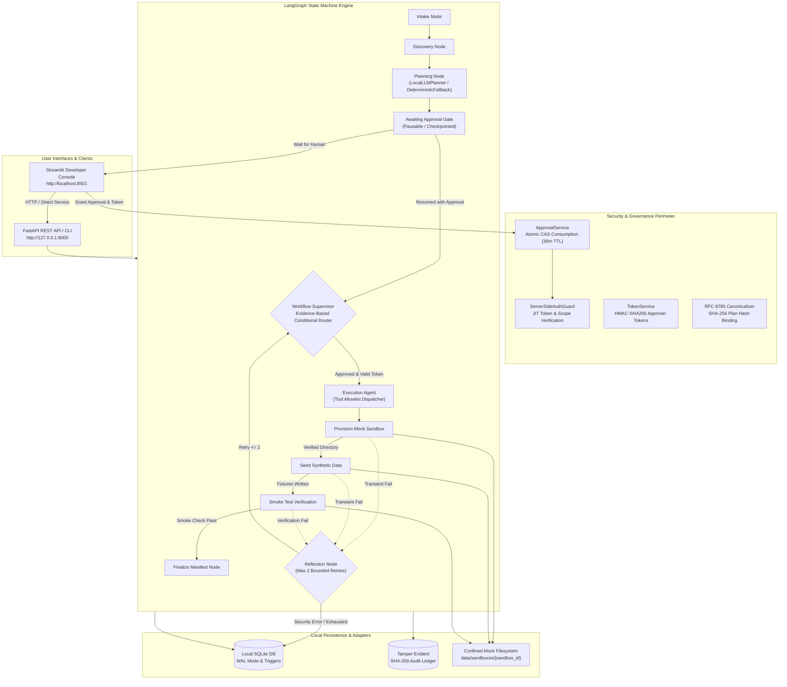

# Developer Sandbox Bootstrapper

A secure, agentic, 100% local sandbox orchestration platform built with **LangGraph**, **FastAPI**, **Streamlit**, and **SQLite**.

The Developer Sandbox Bootstrapper automates the end-to-end lifecycle of developer sandboxes: gathering project requirements, discovering mock repository templates and catalog resources, generating least-privilege execution plans (via deterministic templates or genuine local Ollama LLM inference), enforcing strict server-side human approval, simulating sandbox directory provisioning, seeding isolated synthetic test fixtures, verifying health and consistency, and recording an append-only, SHA-256 tamper-evident cryptographic audit chain.

---

## Table of Contents

1. [Problem Statement & Objectives](#problem-statement--objectives)
2. [Core Features & Capabilities](#core-features--capabilities)
3. [Architecture Overview & Mermaid Diagrams](#architecture-overview--mermaid-diagrams)
4. [Technology Stack & Dependencies](#technology-stack--dependencies)
5. [Prerequisites & Windows Setup](#prerequisites--windows-setup)
6. [Quickstart & PowerShell Run Commands](#quickstart--powershell-run-commands)
7. [End-to-End Workflow Walkthrough](#end-to-end-workflow-walkthrough)
8. [Automated Test Suite & Verification Results](#automated-test-suite--verification-results)
9. [Security Controls & Failure Boundaries](#security-controls--failure-boundaries)
10. [Local-Only Deployment & Optional Ollama LLM Setup](#local-only-deployment--optional-ollama-llm-setup)
11. [Project Directory Structure](#project-directory-structure)
12. [Troubleshooting Guide](#troubleshooting-guide)
13. [Known Limitations & Future Improvements](#known-limitations--future-improvements)

---

## Problem Statement & Objectives

### The Problem
Modern cloud developer sandboxes often suffer from severe operational and security pitfalls:
- **Runaway Cloud Costs**: Developers spin up unmonitored cloud instances, leaving live resources running indefinitely.
- **Accidental Production Contamination**: Test fixtures frequently leak real user records or connect directly to staging/production cloud databases.
- **Overprivileged Autonomous Agents**: AI agents given broad shell access or unreviewed execution privileges can introduce accidental data destruction or credential exposure.
- **Lack of Tamper-Evident Accountability**: Actions taken during environment bootstrap are rarely recorded with cryptographic non-repudiation.

### Project Objectives
1. **100% Local & Zero-Cost at Runtime**: Eliminate cloud dependencies. No cloud subscriptions, external APIs, or hosted databases.
2. **Strictly Simulated Mock Provisioning**: All sandbox environments are sandboxed local directories clearly labeled `MOCK / LOCAL ONLY`.
3. **Synthetic-Only Data Seeding**: Guarantee that zero real PII or production credentials exist. All fixtures use synthetic test domains (`@example.local`) and deterministic hashes.
4. **Human-in-the-Loop Server-Side Governance**: Privileged tools (`PROVISION_MOCK_SANDBOX`, `SEED_SYNTHETIC_DATA`, `EXECUTE_SMOKE_TEST`) can never execute without a cryptographically bound, unexpired human approval record and an authorized JIT token.
5. **Transparent, Hybrid Agentic Architecture**: Genuine optional local AI planning via Ollama with automatic deterministic fallback, coupled with a deterministic Supervisor router and a bounded Reflection recovery node.

---

## Core Features & Capabilities

- **Intake Agent**: Normalizes user project requests, validates naming conventions (`^[a-z0-9][a-z0-9_-]{2,62}$`), verifies requested templates and scopes, and prevents path traversal attempts.
- **Discovery Agent**: Inspects workspace templates and mock service catalogs (`data/mock_resources.json`), surfacing availability warnings for prohibited cloud infrastructure (`cloud-aws-rds`, `cloud-production-idp`).
- **Pluggable Planning Agent**:
  - **Deterministic Baseline**: `DeterministicTemplatePlanner` generates strict, validated, least-privilege step sequences.
  - **Genuine Local LLM Planning**: `LocalLLMPlanner` queries a local Ollama daemon (`POST /api/generate` with `format="json"`), parses candidate steps, derives RFC 8785 canonical plan hashes, and validates the candidate against strict security policies.
  - **Deterministic Fallback**: If Ollama is offline, unreachable, or returns schema-violating candidates, the planner automatically falls back to deterministic template planning with structured audit logging.
- **Workflow Supervisor**: A deterministic, evidence-based LangGraph router that inspects workflow state and filesystem evidence to route transitions between collection, discovery, planning, approval gating, provisioning, seeding, smoke verification, and reflection.
- **Registered Tool Allowlist Dispatcher**: `ExecutionAgent` restricts privileged execution to an explicit allowlist of registered tools (`PROVISION_MOCK_SANDBOX`, `SEED_SYNTHETIC_DATA`, `EXECUTE_SMOKE_TEST`), rejecting unauthorized action types immediately.
- **Reflection & Bounded Recovery**: Distinguishes transient failures (mock I/O locks, verification timeouts) from security failures. Automatically allows up to **2 bounded retries** for transient errors. Security, authorization, and tampering failures halt immediately with zero retries.
- **Server-Side Authorization Guard**: `ServerSideAuthGuard` enforces just-in-time (JIT) token validation, scope containment, 30-minute approval TTL, and single-use compare-and-swap (CAS) approval consumption.
- **RFC 8785 Canonical Plan Binding**: Any plan modification or drift between approval and execution automatically invalidates approvals via database triggers and cryptographic hash mismatch detection.
- **Tamper-Evident SHA-256 Audit Chain**: Every state transition, approval decision, step execution, and security evaluation is recorded in an append-only, SHA-256 hash-chained ledger.
- **Enterprise Developer Console (Streamlit)**: A modern SaaS dashboard featuring KPI cards, interactive request creation, real-time approval granting, step execution tracking, audit log inspection, and configuration toggles.
- **FastAPI REST Backend**: Comprehensive OpenAPI-compliant API binding strictly to `127.0.0.1` for programmatic orchestration.

---

## Architecture Overview & Mermaid Diagrams

### System Architecture Flow



---

## Technology Stack & Dependencies

| Component | Technology | Version / Requirement | Role |
|---|---|---|---|
| **Core Framework** | Python | 3.12+ (tested on 3.14) | Base programming language |
| **Workflow Engine** | LangGraph | >= 0.2.0 | Typed state machine, checkpointing, conditional routing |
| **API Framework** | FastAPI + Uvicorn | >= 0.115.0 | REST backend bound to localhost (`127.0.0.1:8000`) |
| **User Interface** | Streamlit | >= 1.40.0 | Developer console (`http://localhost:8501`) |
| **Data Validation** | Pydantic v2 | >= 2.10.0 | Typed data contracts, settings, and JSON serialization |
| **Persistence** | SQLite3 | Built-in | WAL-mode ACID storage, triggers, and state checkpoints |
| **Security & Crypto** | `hashlib`, `secrets`, `hmac` | Built-in standard library | SHA-256 hash chaining, HMAC-SHA256 token issuance |
| **Optional LLM** | Ollama | Optional local daemon | Genuine structured JSON local inference (llama3.2) |
| **Testing Suite** | Pytest, Pytest-Cov | >= 8.0.0 | Automated testing and statement coverage reporting |

---

## Prerequisites & Windows Setup

### Prerequisites
1. **Operating System**: Windows 10/11 (or macOS / Linux).
2. **Python**: Python 3.12 or newer installed and accessible via PATH.
3. **PowerShell**: Windows PowerShell 5.1 or PowerShell 7 Core.
4. **Git**: Git for Windows installed.
5. **No Cloud Credentials Needed**: AWS, GCP, Azure, or third-party API keys are **never** required.

---

## Quickstart & PowerShell Run Commands

### 1. Initialize the Environment
Run the automated environment setup script:
```powershell
.\scripts\init_env.ps1
```
*What this script does:*
- Creates a virtual environment in `.venv/`.
- Upgrades `pip` and installs all dependencies from `requirements.txt`.
- Copies `.env.example` to `.env` if `.env` does not already exist.
- Initializes the SQLite database schema in `data/sandbox_bootstrapper.db`.
- Bootstraps the initial cryptographic approver token and displays it once.

### 2. Configure Environment (`.env`)
Default safe values in `.env`:
```env
ENVIRONMENT=development
LOG_LEVEL=INFO
DATABASE_PATH=data/sandbox_bootstrapper.db
ENABLE_OLLAMA_PLANNER=false
OLLAMA_BASE_URL=http://localhost:11434
OLLAMA_MODEL=llama3.2
APPROVAL_TTL_MINUTES=30
SANDBOX_RETENTION_HOURS=24
SANDBOX_STORAGE_DIR=data/sandboxes
MANIFEST_STORAGE_DIR=data/manifests
LOCAL_API_HOST=127.0.0.1
LOCAL_API_PORT=8000
LOCAL_UI_PORT=8501
```

### 3. Start the FastAPI Backend
```powershell
.\scripts\start_api.ps1
```
- **Service URL**: `http://127.0.0.1:8000`
- **Interactive Swagger Docs**: `http://127.0.0.1:8000/docs`

### 4. Start the Streamlit Developer Console
Open a new terminal window and run:
```powershell
.\scripts\start_ui.ps1
```
- **Console URL**: `http://localhost:8501`

---

## End-to-End Workflow Walkthrough

1. **Create Sandbox Request**:
   - Navigate to the **Create Sandbox** page in the Streamlit console (or send `POST /requests/`).
   - Select a project template (e.g., `python-fastapi-service`), project name, requested permission scopes, and synthetic fixtures.
   - Click **Submit Request**. The Intake Agent validates and records the request.
2. **Discovery & Planning**:
   - The Discovery Agent inspects template metadata and checks mock resources in `data/mock_resources.json`.
   - The Planning Agent generates a DAG of planned steps. If Ollama is enabled and active, it queries the local LLM; otherwise, it uses the deterministic template planner.
   - An immutable RFC 8785 canonical plan hash is computed and stored.
3. **Human Approval Gate (Pausable)**:
   - The workflow pauses automatically in `PENDING_APPROVAL` status before any privileged tools can execute.
   - Navigate to **Plan & Approval** in the UI. Inspect the planned steps, scopes, and canonical plan hash.
   - Enter an authorized approver token and click **Approve Plan**.
4. **Mock Provisioning & Synthetic Seeding**:
   - The Execution Agent verifies the approval through `ServerSideAuthGuard`.
   - The mock sandbox directory is created under `data/sandboxes/{sandbox_id}` with confined file permissions and `.sandbox-metadata.json`.
   - Synthetic fixtures (`users.json`, `teams.json`, etc.) are generated and committed with path-confinement checks.
5. **Smoke Test Verification & Manifest Finalization**:
   - The Verification Agent validates file hashes, directory permissions, and mock health status (`200 OK`).
   - A final cryptographically signed manifest is generated.
6. **Audit Ledger Review**:
   - Navigate to **Audit Logs** to view the tamper-evident SHA-256 hash-chained log entries proving every state change.

---

## Automated Test Suite & Verification Results

Run the full automated test suite with statement coverage:
```powershell
.\scripts\run_tests.ps1
# Or directly:
.\.venv\Scripts\python.exe -m pytest --cov=src -v
```

### Latest Verified Test Execution Results
```text
============================= test session starts =============================
platform win32 -- Python 3.14.5, pytest-9.1.1, pluggy-1.7.0
rootdir: C:\Users\jalag\Sandbox-Bootstrapper
plugins: anyio-4.15.1, langsmith-0.14.11, cov-7.1.0
collected 191 items

tests/test_agents.py ........................                            [ 12%]
tests/test_api.py .............                                          [ 19%]
tests/test_approvals.py ............                                     [ 25%]
tests/test_audit_chain.py .....                                          [ 28%]
tests/test_audit_concurrency.py .                                        [ 28%]
tests/test_canonicalization.py .........                                 [ 33%]
tests/test_config.py .............                                       [ 40%]
tests/test_data_seeder.py ......                                         [ 43%]
tests/test_execution_tracker.py .....                                    [ 46%]
tests/test_guard.py .........                                            [ 50%]
tests/test_langgraph_workflow.py ............                            [ 57%]
tests/test_models.py ........................                            [ 69%]
tests/test_sandbox_provisioner.py ............                           [ 75%]
tests/test_storage.py ............                                       [ 82%]
tests/test_supervisor_and_recovery.py .......                            [ 85%]
tests/test_tokens.py .......                                             [ 89%]
tests/test_ui.py ...                                                     [ 91%]
tests/test_workflow.py .................                                 [100%]

=============================== tests coverage ================================
TOTAL: 3641 statements, 602 missed, 83% overall statement coverage
====================== 191 passed, 42 warnings in 47.65s ======================
```

### Specialized Verification Modules
- **`tests/test_supervisor_and_recovery.py`**: Validates tool allowlist dispatch, local Ollama structured inference, deterministic template fallback on connection refusal or schema invalidity, transient failure recovery via Reflection bounded retries (up to 2 retries), immediate halting on security/auth failures, and evidence-based Supervisor routing.
- **`tests/test_agents.py`**: Comprehensive 24-requirement test matrix covering intake validation, discovery safety, planning DAG generation, CAS approval consumption, synthetic seeding confinement, and audit persistence.
- **`tests/test_audit_chain.py` & `test_audit_concurrency.py`**: Validates SHA-256 hash-chain integrity, tamper detection, and concurrent write safety.
- **`tests/test_guard.py` & `test_approvals.py`**: Proves server-side authorization enforcement, plan tampering revocation, scope mismatches, and 30-minute approval TTL expiry.

---

## Security Controls & Failure Boundaries

### 1. Fail-Closed Authorization Guard (`ServerSideAuthGuard`)
Every privileged action (`PROVISION_MOCK_SANDBOX`, `SEED_SYNTHETIC_DATA`, `EXECUTE_SMOKE_TEST`) must pass through `ServerSideAuthGuard.evaluate()`. Execution fails closed if:
- The human approval record is missing, rejected, expired (>30 minutes), or revoked.
- The approval was already consumed (preventing replay attacks via atomic CAS transactions).
- The active plan hash does not match the approval record's `canonical_plan_hash`.
- The caller token is invalid, expired, or lacks the required permission scope.

### 2. RFC 8785 Canonical Plan Hashing
Plans are serialized using RFC 8785 deterministic JSON canonicalization. Any modification to step ordering, parameters, fixtures, or scopes changes the SHA-256 hash, causing the execution guard to reject the approval with `PlanTamperingError`.

### 3. Path Traversal & Shell Injection Defense
- **Path Confinement**: `src/adapters/path_utils.py` resolves canonical paths and verifies that all operations remain confined within `data/sandboxes/`. Symlink escapes and directory traversal sequences (`..`, `/`, `\`) trigger `PathTraversalError`.
- **Command Injection Prevention**: The system never invokes `shell=True`, `subprocess.Popen`, `os.system()`, or `eval()`. All mock provisioning is performed via native Python filesystem operations.

### 4. Single-Display Cryptographic Tokens
Approver tokens are generated with 256 bits of cryptographically secure entropy (`secrets.token_urlsafe(32)`). Only the SHA-256 hash is persisted in SQLite. Raw tokens are never logged or returned in subsequent API responses.

### 5. Tamper-Evident SHA-256 Audit Chain
Every audit event contains:
`entry_hash = SHA256(event_id + request_id + event_type + timestamp + payload_hash + previous_entry_hash)`
Database triggers prohibit `UPDATE` or `DELETE` on the `audit_chain` table. Any manual alteration of database records invalidates the hash chain and is immediately flagged.

---

## Local-Only Deployment & Optional Ollama LLM Setup

### Local-Only Guarantee
- The application binds strictly to loopback addresses (`127.0.0.1` and `localhost`).
- No telemetry, external DNS lookups, cloud API keys, or remote dependencies exist.
- Storage is 100% contained within local SQLite (`data/sandbox_bootstrapper.db`) and local directories (`data/sandboxes/`).

### Optional Local Ollama LLM Configuration
By default, LLM inference is disabled (`ENABLE_OLLAMA_PLANNER=false`), and all plans are generated deterministically.

To enable genuine local Ollama AI planning:
1. Install [Ollama](https://ollama.ai/) locally on your workstation.
2. Pull the default lightweight model:
   ```powershell
   ollama pull llama3.2
   ```
3. Update `.env`:
   ```env
   ENABLE_OLLAMA_PLANNER=true
   OLLAMA_BASE_URL=http://localhost:11434
   OLLAMA_MODEL=llama3.2
   ```
4. Restart the backend or UI. The Planning Agent will query `POST /api/generate` requesting structured JSON matching the candidate plan schema, validate the candidate against security constraints, and safely fall back to the deterministic template planner if Ollama is stopped or unreachable.

---

## Project Directory Structure

```text
Sandbox-Bootstrapper/
├── .editorconfig                              # Code formatting rules
├── .env.example                               # Safe environment template
├── .gitattributes                             # Git line-ending normalization
├── .gitignore                                 # Exclusion rules for secrets, DBs, venvs
├── CONTRIBUTING.md                            # Development guidelines & contribution rules
├── README.md                                  # System documentation
├── requirements.txt                           # Pinned dependencies
│
├── data/
│   └── mock_resources.json                    # Mock resource catalog (templates, databases, IDPs)
│
├── docs/architecture/                         # Comprehensive architectural specifications
│   ├── architecture-decisions.md              # Architecture Decision Records (ADRs)
│   ├── data-contracts.md                      # JSON schemas & database entity specifications
│   ├── requirements-traceability.md           # Requirements mapping matrix
│   ├── system-architecture.md                 # Detailed component diagrams and data flows
│   ├── test-strategy.md                       # Test pyramid and assurance strategy
│   └── threat-model.md                        # STRIDE threat model & mitigations
│
├── scripts/                                   # PowerShell helper scripts
│   ├── init_env.ps1                           # Automated venv creation, pip install, DB initialization
│   ├── run_tests.ps1                          # Full test suite runner with coverage
│   ├── start_api.ps1                          # FastAPI backend runner (127.0.0.1:8000)
│   └── start_ui.ps1                           # Streamlit console runner (localhost:8501)
│
├── src/                                       # Core source code
│   ├── adapters/                              # Infrastructure adapters & mock filesystem execution
│   │   ├── data_seeder.py                     # Synthetic data seeder with path confinement
│   │   ├── execution_tracker.py               # Step status recorder & checkpoint tracker
│   │   ├── fixtures.py                        # Deterministic synthetic data fixture schemas
│   │   ├── path_utils.py                      # Path traversal & symlink prevention
│   │   └── sandbox_provisioner.py             # Mock sandbox creator & metadata recorder
│   ├── agents/                                # Specialized workflow agents
│   │   ├── discovery.py                       # Discovery Agent (scans mock repo assets)
│   │   ├── executor.py                        # Execution Agent (registered tool allowlist dispatcher)
│   │   ├── intake.py                          # Intake Agent (validates bootstrap requests)
│   │   ├── planner.py                         # Planning Agent (delegates to template or Ollama LLM)
│   │   ├── reflection.py                      # Reflection Node (evaluates failure eligibility & bounded retry)
│   │   └── verification.py                    # Verification Agent (executes post-execution smoke checks)
│   ├── api/                                   # FastAPI backend REST service
│   │   ├── app.py                             # FastAPI app definition & middleware
│   │   ├── deps.py                            # Dependency injection providers
│   │   ├── errors.py                          # HTTP exception handlers & security mappings
│   │   └── routes/
│   │       ├── requests.py                    # Request lifecycle, approvals, resume, logs
│   │       └── tokens.py                      # JIT token generation & validation
│   ├── core/                                  # Foundation & cross-cutting concerns
│   │   ├── config.py                          # Application settings (Pydantic Settings)
│   │   └── exceptions.py                      # Typed domain exceptions (security, auth, workflow)
│   ├── models/                                # Pydantic v2 data models & domain contracts
│   │   ├── approvals.py                       # Approval records, decisions, guard context
│   │   ├── audit.py                           # Hash-chained tamper-evident audit records
│   │   ├── enums.py                           # Workflow statuses, step action types, permission scopes
│   │   ├── manifest.py                        # Sandbox manifest schema & smoke evidence
│   │   ├── plans.py                           # Setup plan, planned steps, candidate schemas
│   │   ├── requests.py                        # Bootstrap request models & validations
│   │   ├── retention.py                       # Sandbox retention & cleanup policies
│   │   └── workflow.py                        # LangGraph workflow state & checkpoint schemas
│   ├── security/                              # Enterprise security & authorization controls
│   │   ├── approvals.py                       # Approval lifecycle & cryptographic binding
│   │   ├── audit_chain.py                     # SHA-256 tamper-evident hash-chained audit ledger
│   │   ├── canonicalization.py                # RFC 8785 JSON canonicalizer & plan hashing
│   │   ├── guard.py                           # ServerSideAuthGuard (JIT token & scope enforcement)
│   │   ├── policy.py                          # Scope definitions & privilege boundaries
│   │   └── tokens.py                          # HMAC-SHA256 token issuance & verification
│   ├── storage/                               # Persistence layer (Local SQLite)
│   │   ├── connection.py                      # SQLite connection management & WAL mode
│   │   └── db_init.py                         # DDL schemas, table creation, indexes
│   ├── ui/                                    # Streamlit developer console
│   │   └── app.py                             # Modern SaaS console dashboard
│   └── workflow/                              # LangGraph orchestration engine
│       ├── discovery.py                       # Local template discovery provider
│       ├── graph.py                           # StateGraph definition, nodes, conditional edges
│       ├── orchestrator.py                    # High-level workflow orchestrator & checkpointing
│       ├── planner.py                         # DeterministicTemplatePlanner & LocalLLMPlanner
│       ├── supervisor.py                      # WorkflowSupervisor (evidence-based conditional routing)
│       └── verifier.py                        # SandboxVerifier (fixture hashing & verification checks)
│
└── tests/                                     # Automated test suite (191 tests, 83% coverage)
    ├── conftest.py                            # Shared fixtures & test database setup
    ├── test_agents.py                         # 24-requirement Master Prompt test suite
    ├── test_api.py                            # FastAPI endpoint tests
    ├── test_approvals.py                      # Human approval binding & revocation tests
    ├── test_audit_chain.py                    # SHA-256 hash-chain integrity tests
    ├── test_audit_concurrency.py              # Concurrent audit write safety tests
    ├── test_canonicalization.py               # RFC 8785 deterministic JSON formatting tests
    ├── test_config.py                         # Configuration loading & validation tests
    ├── test_data_seeder.py                    # Synthetic data seeding & path traversal tests
    ├── test_execution_tracker.py              # Step execution tracking tests
    ├── test_guard.py                          # ServerSideAuthGuard authorization tests
    ├── test_langgraph_workflow.py             # LangGraph state transitions & checkpoints
    ├── test_models.py                         # Pydantic schema validation tests
    ├── test_sandbox_provisioner.py            # Local mock sandbox provisioning tests
    ├── test_storage.py                        # SQLite schema & transaction tests
    ├── test_supervisor_and_recovery.py        # Ollama, supervisor routing, reflection retries
    ├── test_tokens.py                         # HMAC token lifecycle & scope tests
    ├── test_ui.py                             # Streamlit UI smoke & backend contract tests
    └── test_workflow.py                       # End-to-end workflow execution & resumption tests
```

---

## Troubleshooting Guide

### 1. Port Already in Use (`8000` or `8501`)
If another service is using port 8000 or 8501:
- Find the process using the port in PowerShell:
  ```powershell
  Get-NetTCPConnection -LocalPort 8000 -ErrorAction SilentlyContinue | Select-Object OwningProcess
  ```
- Terminate the process or adjust `LOCAL_API_PORT` / `LOCAL_UI_PORT` in `.env`.

### 2. Missing SQLite Database
If `data/sandbox_bootstrapper.db` does not exist:
```powershell
.\.venv\Scripts\python.exe -m src.storage.db_init
```

### 3. Lost or Forgotten Approver Token
Generate a new approver token using the CLI:
```powershell
.\.venv\Scripts\python.exe -m src.security.policy
```
*Note: Copy the printed raw token immediately. Tokens are displayed once and never stored in plaintext.*

### 4. Ollama LLM Connection Refused
If `ENABLE_OLLAMA_PLANNER=true` but Ollama is not running:
- The system logs a structured warning and automatically falls back to `DeterministicTemplatePlanner`. The workflow will not fail or crash.
- To resolve, start the Ollama service:
  ```powershell
  ollama serve
  ```

---

## Known Limitations & Future Improvements

1. **Local Workstation Trust Boundary**: Approver authentication protects against accidental execution, UI bypasses, and unreviewed runs. It is not designed as an enterprise multi-tenant IAM service.
2. **Immutability Boundaries**: Immutability of the SQLite audit chain is enforced against application-level manipulation via triggers and SHA-256 hash chaining. An OS administrator with direct disk write permissions to `.db` files could alter them directly on disk.
3. **Mock Provisioning Scope**: The provisioner simulates directory creation, configuration files, and fixture injection. It does not spin up Docker containers or Kubernetes namespaces.
4. **Future Expansion**:
   - Docker container sandbox adapter with CPU/memory cgroup limits.
   - Remote OIDC approver role validation.
   - Multi-agent debate between Planning and Security Evaluation agents before human review.