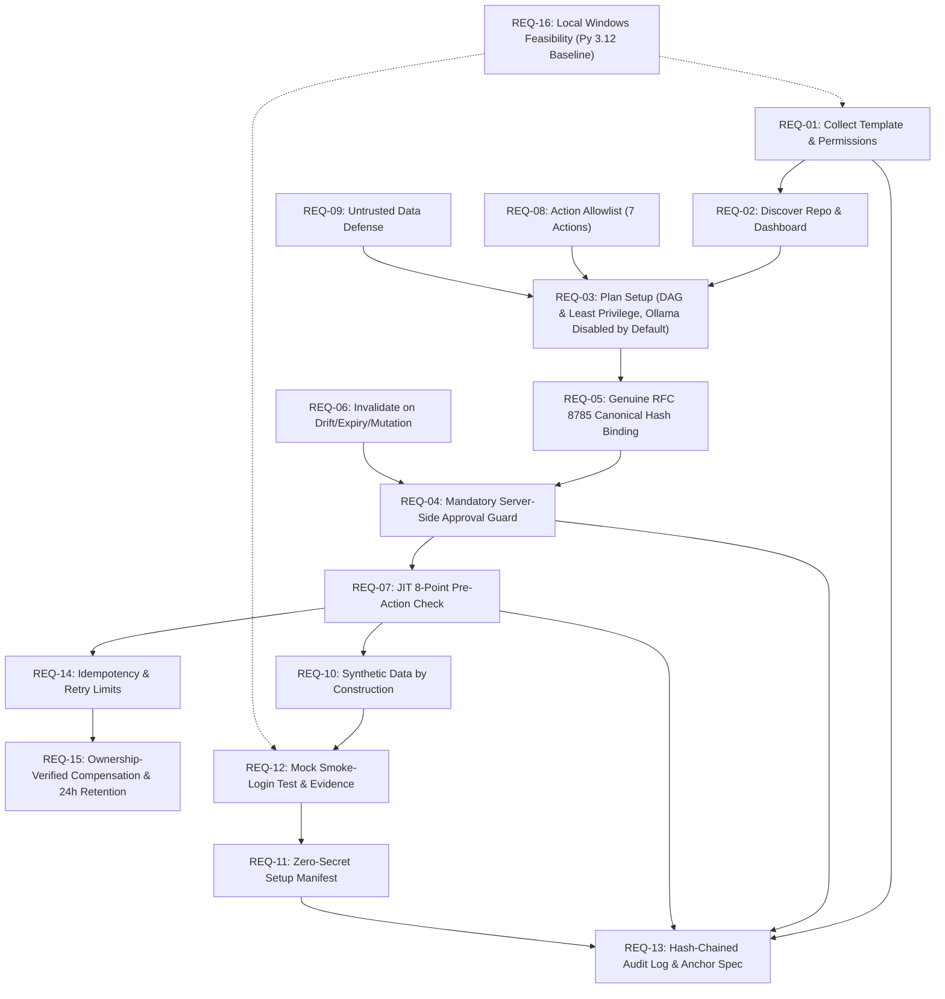

# Requirements Traceability Matrix: Developer Sandbox Bootstrapper

**Document Version:** 1.3.0  
**Status:** PROPOSED FOR REVIEW (ARCHITECTURE PLANNING ONLY)  
**Date:** 2026-10-16  

> [!NOTE]
> **Planning Phase Declaration:** The verification test cases listed in this matrix represent **designed and planned automated test specifications**. In accordance with architectural governance, no test is claimed to have passed until executed and verified in the automated test runner during the subsequent implementation phase.

---

## 1. Overview & Traceability Methodology

This document establishes bidirectional traceability between all functional, security, architectural, and operational requirements defined in the project specification and their corresponding system components, data schemas, security controls, and planned automated test cases.

Every requirement maps to:
1. One responsible architectural component.
2. One strict schema or policy constraint.
3. One planned automated test case (unit, integration, failure injection, or security).

---

## 2. Requirements Traceability Matrix (RTM)

| Req ID | Requirement Statement | Architectural Component | Data Model / Schema | Security Control | Verification Test Case(s) | Verification Method | Priority |
| :--- | :--- | :--- | :--- | :--- | :--- | :--- | :--- |
| **REQ-01** | Collect project template and requested permissions from the developer. | Streamlit Frontend (`app.py`), FastAPI Backend (`routes/requests.py`) | `BootstrapRequestCreate`, `ProjectTemplate`, `PermissionScope` | Strict schema enum validation; rejection of unrecognized templates or unlisted permissions. | `TC-UNIT-001`, `TC-INT-001` | Automated Schema Test & API Integration Test | P0 |
| **REQ-02** | Discover setup information from target repository and sandbox dashboard. | Mock Repo Adapter (`mock_repo.py`), Mock Dashboard Adapter (`mock_dashboard.py`), LangGraph Orchestrator | `RepoDiscoveryResult`, `DashboardDiscoveryResult` | Path traversal containment (`is_relative_to`), read-only filesystem access, isolated mock store queries. | `TC-UNIT-002`, `TC-SEC-001`, `TC-INT-002` | Unit Test & Security Path Traversal Injection Test | P0 |
| **REQ-03** | Plan setup steps in dependency order enforcing least privilege. Deterministic planner is baseline; Ollama disabled by default. | Planner (`template_planner.py`, `llm_planner.py`), Policy Engine (`engine.py`) | `SetupPlan`, `PlannedStep`, `StepActionType` | Topological DAG sort, cycle detection, scope minimality check; only requested scopes can be assigned. | `TC-UNIT-003`, `TC-UNIT-004`, `TC-SEC-002` | Unit DAG Algorithm Test & Least Privilege Boundary Test | P0 |
| **REQ-04** | Require explicit server-side human approval before sandbox creation and data seeding via shared authorization guard inside adapters. | Shared Auth Guard (`ServerSideAuthGuard`), Mock Provisioner, Synthetic Seeder | `ApprovalRecord`, `WorkflowState` | LangGraph interrupt handles workflow pause; shared server-side authorization guard inside both adapters enforces 8-point check immediately before action. | `TC-INT-003`, `TC-SEC-003`, `TC-SEC-016` | Integration Gating Test & Direct Adapter Invocation Probe | P0 |
| **REQ-05** | Bind approval to a canonical hash of exact plan, permissions, env, fixtures. Server-side token identity resolution; atomic CAS consumption. | Policy Engine (`canonical_hasher.py`), SQLite Storage (`db.py`) | `CanonicalApprovalPayload`, `ApprovalRecord`, `ApproverIdentity` | Genuine RFC 8785 JCS (code points preserved, no NFC normalization) + SHA-256 fingerprint; server resolves identity via hashed token; atomic CAS `BEGIN IMMEDIATE` query bound to 8 parameters. | `TC-UNIT-005`, `TC-UNIT-011`, `TC-SEC-004`, `TC-SEC-017` | Canonical RFC 8785 Test Suite & Forged Approval Rejection Test | P0 |
| **REQ-06** | Invalidate and reject approval if plan changes (plan drift), permissions change, or approval expires (TTL). | Policy Engine (`engine.py`), SQLite Triggers | `ApprovalRecord`, `SetupPlan` | 30-minute TTL check; database trigger `revoke_approvals_on_plan_change` marks approvals `is_revoked = 1` on plan/scope mutation. | `TC-SEC-005`, `TC-SEC-006`, `TC-SEC-019` | Expired Approval Rejection Test & Plan Mutation Auto-Revocation Test | P0 |
| **REQ-07** | Revalidate permissions and approval immediately before every privileged action (JIT 8-point revalidation check). | Shared Auth Guard (`auth_guard.py`), Adapters | `StepExecutionResult`, `ApprovalRecord` | Mandatory 8-point check executed inside provisioner and seeder immediately prior to privileged execution. | `TC-SEC-007`, `TC-SEC-016`, `TC-INT-004` | In-Flight Revocation Test & Mid-Execution Revalidation Test | P0 |
| **REQ-08** | Enforce an allowlist of permitted actions and least-privilege scoping. | Policy Engine (`allowlist.py`) | `StepActionType`, `PermissionScope` | Closed enum allowlist (7 actions only); any unknown action string triggers an immediate fatal policy error. | `TC-UNIT-006`, `TC-SEC-008` | Arbitrary Action Injection Test | P0 |
| **REQ-09** | Never execute arbitrary shell commands or Python code from repo or LLM output; treat repo & LLM as untrusted. | Planner Sanitizer (`sanitizer.py`), Mock Adapters | `LLMPlanCandidate`, `Pydantic Sanitizer` | Zero use of `subprocess.run(shell=True)`, `os.system`, `eval`, or `exec`. All actions are typed Python adapters. Ollama disabled by default. | `TC-SEC-009`, `TC-SEC-010` | Prompt Injection Shell-Breakout Test & Code Execution Probe Test | P0 |
| **REQ-10** | Use synthetic test data only; prevent real credentials or live customer PII from entering the environment. | Synthetic Data Seeder (`synthetic_seeder.py`) | `SyntheticDataFixture`, `SeedSummary` | Generation by construction (deterministic seeded Faker); production imports structurally prohibited; regex scanner as secondary defense-in-depth. | `TC-UNIT-007`, `TC-SEC-011` | Data Seeder Unit Test & PII Regex Interception Test | P0 |
| **REQ-11** | Generate a tamper-evident JSON setup manifest with zero secrets and canonical integrity hash. | Manifest Generator (`manifest.py`), Storage | `SetupManifest`, `ManifestSignatureMetadata` | Redaction filter replaces all tokens/keys with `[REDACTED]`; computes genuine RFC 8785 SHA-256 digest of final manifest. | `TC-UNIT-008`, `TC-SEC-012` | Manifest Generation Test & Secret Redaction Audit Test | P0 |
| **REQ-12** | Run a smoke-login test, clearly distinguishing mock login from real IdP authentication. Record concrete assertions and evidence. | Smoke Test Adapter (`smoke_test.py`) | `SmokeTestResult`, `SmokeTestEvidence` | Simulated local HTTP handshake; asserts health 200, mock login 200 with mock JWT claims; records latency & evidence; displays mandatory disclaimer. | `TC-UNIT-009`, `TC-INT-005`, `TC-INT-008` | Mock Smoke Login Test & Disclaimer Field Verification Test | P0 |
| **REQ-13** | Record auditable, hash-chained state transitions. SQLite triggers provide app-level protection; document file-control limits and external anchor. | Audit Logger (`audit.py`), SQLite Storage (`db.py`) | `AuditEvent`, `AuditEventType`, `AuditSeverity` | Hash-chained event log (`prev_hash + payload_hash`); SQLite triggers block app updates/deletes; file rewrite limitation documented; external WORM sink identified. | `TC-INT-006`, `TC-SEC-010`, `TC-SEC-014` | Audit Log Hash-Chain Test & Tamper Resistance Test | P0 |
| **REQ-14** | Implement idempotency, retry limits, concurrency protection, and partial-failure handling. | FastAPI Middleware (`idempotency.py`), SQLite | `IdempotencyRecord`, `WorkflowState` | Header `Idempotency-Key` unique constraint, atomic SQL state transitions, bounded retries (max 3 with jittered backoff), SQLite WAL mode. | `TC-INT-007`, `TC-FAIL-001`, `TC-FAIL-002` | Concurrent Request Collision Test & Bounded Retry Limit Test | P1 |
| **REQ-15** | Handle partial failure gracefully with safe, ownership-verified compensation and enforce retention/disk controls. | LangGraph Compensation Handler (`compensation.py`), Reconciler | `CompensationRecord`, `ResourceOwnershipMetadata`, `WorkflowState` | Transitions to `PARTIALLY_FAILED`; compensation verifies sandbox directory ownership tags before deletion; 24h default TTL, 1h failure quarantine, max 5 sandboxes/10GB quota; audit records retained indefinitely. | `TC-FAIL-003`, `TC-FAIL-004`, `TC-SEC-015`, `TC-INT-009`, `TC-SEC-018` | Mid-Seeding Crash Simulation Test & Resource Ownership Cleanup Test | P1 |
| **REQ-16** | Local-first Windows execution with mock adapters and zero cloud or Docker lock-in. | Mock Tool Adapters, Python standard runtime | Configuration Environment Settings | Runs entirely on local Windows with standard Python; mock adapters simulate cloud resources without live accounts; Python 3.12 recommended baseline. | `TC-E2E-001` | Full Local End-to-End Walkthrough on Windows | P0 |

---

## 3. Requirement Dependency & Flow Graph

---

## 4. Verification Gap Analysis & Completeness Check

1. **Uncovered Requirements:** None. All 16 core architectural requirements map directly to components, models, and test specifications.
2. **Untestable Criteria:** None. Every requirement is formulated with measurable success criteria (e.g., exact hash match against official RFC 8785 vectors, zero regex PII hits, max 3 retries, zero shell executions, hash-chain integrity verification).
3. **Execution Status:** As this is an architecture planning deliverable, all test cases represent **designed verification specifications**. None are reported as executed or passed.
