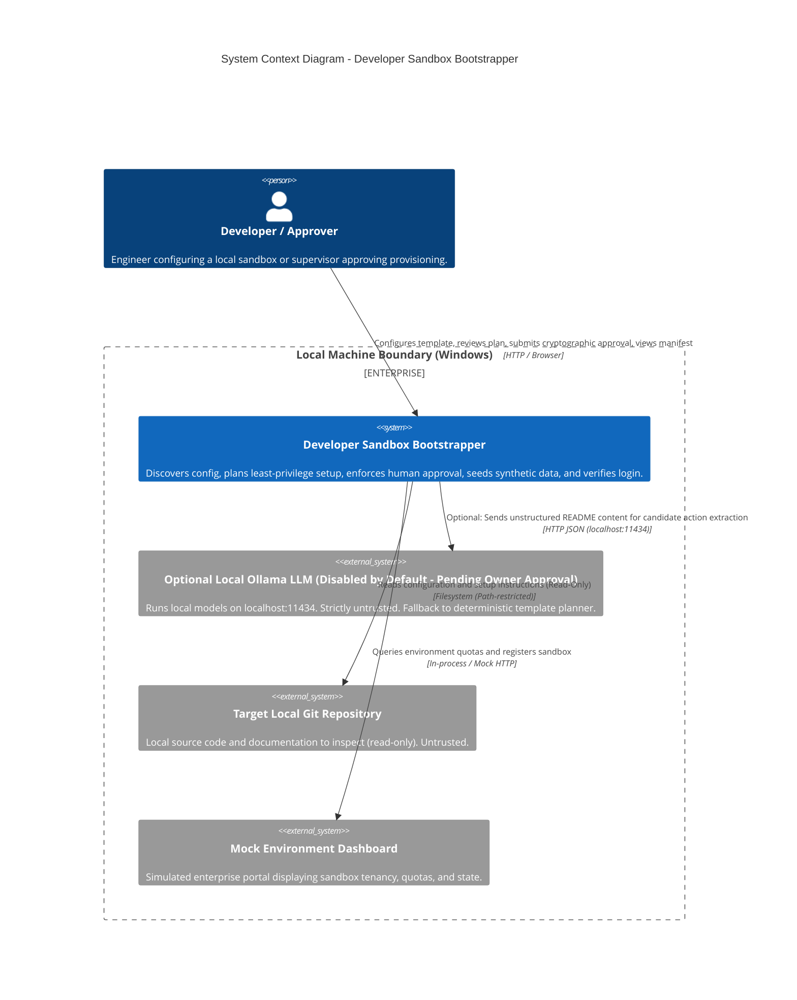
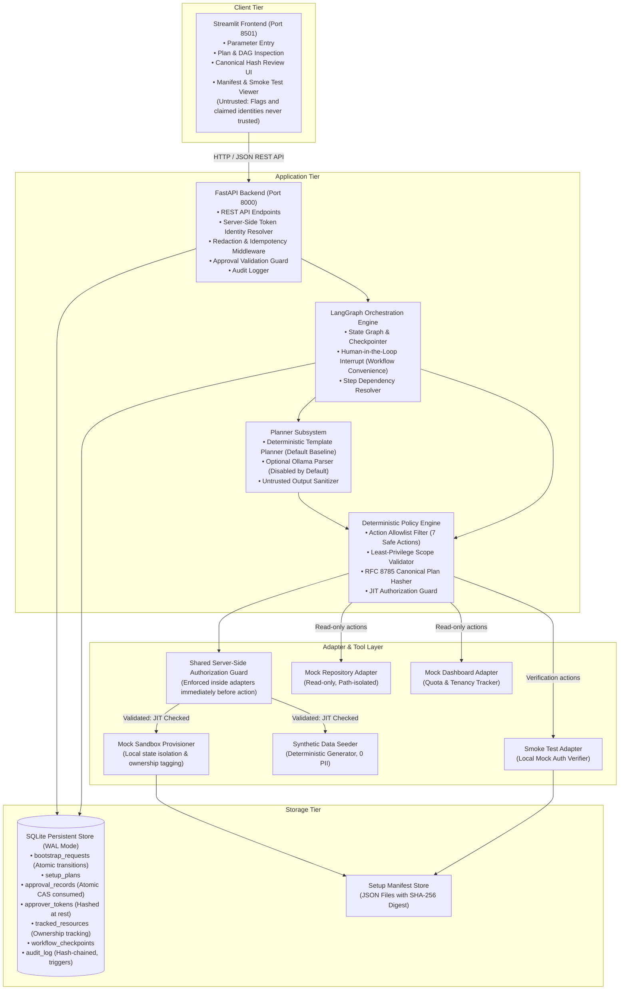
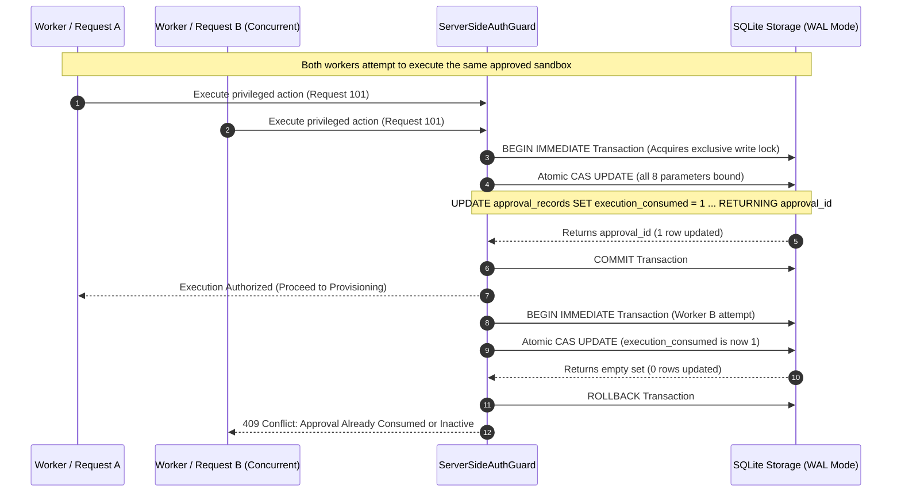
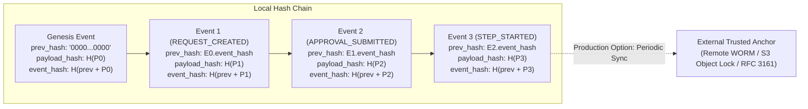

# System Architecture Specification: Developer Sandbox Bootstrapper

**Document Version:** 1.3.0  
**Status:** PROPOSED FOR REVIEW (ARCHITECTURE PLANNING ONLY)  
**Date:** 2026-10-16  
**Target Environment:** Local Windows Development (PowerShell, Python 3.12 recommended / 3.14 evaluated)  
**Security Classification:** Restricted / Defensive Architecture  

---

## 1. Executive Summary & Problem Context

In enterprise and developer AI engineering, setting up an isolated, functional test environment for new engineers or automated evaluation agents is fraught with security and reliability pitfalls:
1. **Over-privileged environments:** Developers frequently receive excessive credentials or broad administrative roles rather than least-privilege sandbox access.
2. **Untrusted documentation & setup scripts:** Setup instructions in repositories (e.g., `README.md`, setup scripts) or arbitrary AI model outputs may contain outdated, incorrect, malicious, or vulnerable instructions (including indirect prompt injections).
3. **Absence of human governance:** Automated bootstrap tooling often runs destructive provisioning or data seeding without explicit, tamper-evident sign-off from designated project owners.
4. **Data leakage:** Production credentials or live customer PII are routinely cloned into local environments.
5. **Partial failures & state corruption:** Interrupted provisioning leads to zombie resources, inconsistent state, and unreproducible testing conditions.

The **Developer Sandbox Bootstrapper** solves these issues through a strictly bounded, local-first, defense-in-depth architecture. It collects setup parameters, discovers repository and dashboard configuration, uses deterministic planning as the primary baseline (with an optional local LLM disabled by default pending owner approval), filters all actions through a **deterministic policy engine**, mandates **server-side cryptographic human approval** before privileged steps, seeds **synthetic-only data**, generates a signed **setup manifest**, and runs a **mock smoke-login verification** while explicitly distinguishing mock credentials from enterprise Identity Provider (IdP) authentication.

---

## 2. Verified Repository State & Foundation

A physical inspection of `c:\Users\jalag\Sandbox-Bootstrapper` conducted on 2026-10-16 established the following ground truth:

| Dimension | Verified Fact | Architectural Impact / Constraint |
| :--- | :--- | :--- |
| **Workspace Tree** | Only `.git` directory and a 22-byte [README.md](file:///c:/Users/jalag/Sandbox-Bootstrapper/README.md) (`# Sandbox-Bootstrapper`). | Clean slate. No legacy code, package conflicts, or conflicting schemas exist. |
| **Git Status** | Branch `main`, tracking `origin/main`, clean working tree (`e01fd9c Initial commit`). | All architecture documentation is cleanly introduced without altering application files or commits. |
| **Operating System** | Windows (NT kernel), PowerShell execution environment. | All file paths, process controls, port bindings, and subprocess invocations must account for Windows semantics (`pathlib.Path`, forward-slash normalization, `PRAGMA busy_timeout = 5000`). |
| **Python Environment** | Python 3.14.5, `pip` 26.1.1 installed in `C:\Python314`. Package manager `uv` is not present on PATH. | Because Python 3.14 is a very recent release, compiled wheels for certain dependencies (e.g., `pydantic-core`, `greenlet`) may lack prebuilt binaries. **Python 3.12 is recommended as the baseline target** if binary wheel issues arise during virtual environment creation. Compatibility has not yet been established through test execution. |
| **Existing Dependencies** | Zero third-party packages installed in workspace root. | Complete control over package dependencies. All third-party libraries must be pinned with strict security review. |

---

## 3. High-Level Architecture & System Boundaries

The system follows a modular, decoupled architecture comprising a presentation tier (Streamlit), an orchestration and API tier (FastAPI + LangGraph), a deterministic rule and policy tier, a typed adapter layer with mock implementations, and an append-only persistence tier (SQLite).

### 3.1 C4 Level 1: System Context Diagram



### 3.2 C4 Level 2: Container Diagram



---

## 4. Component Responsibilities & Detailed Security Boundaries

### 4.1 LangGraph Interrupt vs. True Security Boundary

> [!IMPORTANT]
> **Architectural Invariant:** The LangGraph human-in-the-loop interruption mechanism (`interrupt_before=["provision_sandbox", "seed_synthetic_data"]`) is an **orchestration workflow convenience**, NOT the system's security boundary.
> 
> Security cannot rely on graph topology alone, because an orchestrator bug, thread state corruption, or direct internal call could inadvertently invoke a tool adapter. Therefore, **the true security boundary is a Shared Server-Side Authorization Guard (`ServerSideAuthGuard`) embedded directly inside both the `MockSandboxProvisioner` and `SyntheticDataSeeder`.**

```
+----------------------------------------------------------------------------------------------------+
| ServerSideAuthGuard: Mandatory 8-Point Revalidation (Executed inside adapter right before action) |
|                                                                                                    |
| 1. Authenticated Approval Record Exists in SQLite (Resolved via server token, not client flag)     |
| 2. Request ID matches exactly                                                                      |
| 3. Canonical Plan Hash matches stored plan and approval record (RFC 8785 SHA-256)                  |
| 4. Plan Version matches active plan version                                                        |
| 5. Target Environment matches approved target environment                                          |
| 6. Required Permission Scope is granted in the approval record for this specific action            |
| 7. Approval Expiry: utcnow() <= approval.expires_at (Default 30-minute TTL)                        |
| 8. Atomic Consumption State: Unconsumed (execution_consumed == 0), revoked == 0, updated via CAS  |
+----------------------------------------------------------------------------------------------------+
```

---

### 4.2 Approver Authentication & Server-Side Identity Resolution

> [!CAUTION]
> **Zero Trust in Client-Supplied Identity:** The system **never trusts a client-supplied identity header (e.g. `X-Approver-Id`) or request body field** as proof of identity. The approver identity is established strictly by the server through authenticated token resolution.

```
+------------------------------------------------------------------------------------+
| Server-Side Approver Identity & Token Resolution Lifecycle                         |
|                                                                                    |
| [ Client Request ]                                                                 |
|   Header: Authorization: Bearer <token> (or X-Approver-Token)                      |
|       │                                                                            |
|       ▼                                                                            |
| [ FastAPI Authentication Middleware ]                                              |
|   1. Extract raw token; strip & redact from all request logs / error traces.       |
|   2. Compute SHA-256(raw_token).                                                   |
|   3. Constant-Time Lookup: hmac.compare_digest against server-side token hashes.    |
|   4. Retrieve immutable ApproverIdentity(approver_id, role, authorized_scopes).    |
|   5. Validate token active status (revoked_at IS NULL).                            |
|       │                                                                            |
|       ▼                                                                            |
| [ Server Binds Identity to ApprovalRecord ]                                        |
|   approver_id := identity.approver_id (Server-determined, immutable)               |
+------------------------------------------------------------------------------------+
```

#### Detailed Token Lifecycle & Governance:
1. **Token Generation:** Generated using a cryptographically secure pseudorandom number generator:
   ```python
   raw_token = secrets.token_urlsafe(32)  # 256 bits of cryptographic entropy
   ```
2. **Secure Storage (Hashed at Rest):** Plaintext tokens are **never stored** in the database or persistent configuration. The backend stores:
   $$\text{stored\_token\_hash} = \text{SHA-256}(\text{raw\_token})$$
3. **Redaction from Logs:**
   - Dedicated FastAPI middleware intercepts all incoming requests and outgoing responses.
   - Any header named `Authorization`, `X-Approver-Token`, or any payload property named `token`, `password`, or `secret` is scrubbed and replaced with `[REDACTED]`.
   - Audit logs, application logs, and HTTP error traces never contain raw tokens.
4. **Comparison:** All token hash comparisons use constant-time verification (`hmac.compare_digest`) to prevent timing side-channel attacks.
5. **Revocation & Rotation:**
   - Tokens can be revoked administratively by populating `revoked_at` timestamp in SQLite.
   - Rotation generates a new secure token, stores its hash, and invalidates the prior token.

---

### 4.3 Atomic Approval Consumption & Concurrency Control

To guarantee that concurrent requests or race conditions cannot both execute the same approval, the system enforces **atomic Compare-And-Swap (CAS) consumption inside a dedicated SQLite transaction**:



#### Atomic CAS Update Query:
```sql
UPDATE approval_records 
SET execution_consumed = 1,
    consumed_at = :now
WHERE approval_id = :approval_id 
  AND request_id = :request_id
  AND canonical_plan_hash = :canonical_plan_hash
  AND plan_version = :plan_version
  AND target_environment = :target_environment
  AND granted_scopes = :granted_scopes_json
  AND is_revoked = 0 
  AND execution_consumed = 0 
  AND expires_at >= :now
RETURNING approval_id;
```
- **Transaction Isolation:** Uses `BEGIN IMMEDIATE` in SQLite WAL mode. This guarantees that SQLite immediately upgrades to a reserved write lock, preventing conflicting concurrent readers from interleaving before the update.
- **Concurrency Result:** Exactly one concurrent execution can succeed. Any simultaneous or replay attempt finds `execution_consumed == 1` (or matching condition false), returns zero rows, and aborts with HTTP 409 Conflict.

---

### 4.4 Automated Invalidation on Plan or Scope Mutation

Any modification to an existing request, plan, or requested permissions immediately invalidates prior approvals:

1. **Cryptographic Invalidation:** Changing even a single parameter, action type, dependency, or scope changes the RFC 8785 canonical bytes, generating a completely different `canonical_plan_hash`. Any subsequent CAS execution query comparing hashes fails immediately.
2. **Explicit Database Invalidation Trigger:**
   Whenever a plan is regenerated or updated (`UPDATE setup_plans` or `PUT /requests/{id}/plan`), the application executes:
   ```sql
   UPDATE approval_records 
   SET is_revoked = 1,
       rejection_reason = 'AUTOMATICALLY_REVOKED: Plan or permission scope modified post-approval'
   WHERE request_id = :request_id 
     AND execution_consumed = 0;
   ```
   This ensures that even if an attacker attempts to replay an old approval ID, the record is explicitly flagged as revoked in the database.

---

### 4.5 Genuine RFC 8785 Canonicalization Specification

> [!WARNING]
> **Correction of Unicode Normalization Claim:** Section 3.2.2 of RFC 8785 (JSON Canonicalization Scheme - JCS) explicitly states: *"Unicode strings are NOT normalized."* JCS does **not** perform Unicode Normalization Form C (NFC) or Form D (NFD) transformations. Code points must be preserved exactly as presented. Claiming that RFC 8785 normalizes Unicode to NFC was an error and is hereby corrected.

The architecture mandates genuine compliance with **RFC 8785 (JSON Canonicalization Scheme - JCS)** using an established, tested library (e.g., `rfc8785` or `canonicaljson`). A custom JSON serializer is prohibited:
- **Unicode Handling:** Strings are encoded in UTF-8 without byte order marks (BOM). Unicode characters are **not normalized**; code points are preserved as provided. Character escaping follows strict RFC 8785 rules (only `\"`, `\\`, and control characters `\u0000` through `\u001f` are escaped; all other code points are output as raw UTF-8 bytes).
- **Key Ordering:** Object keys are sorted lexicographically by their UTF-16 code units (as specified in ECMA-404 and RFC 8785 Section 3.2.3).
- **Number Formatting:** Numbers conform to ECMAScript standard number formatting:
  - Integers within the IEEE 754 double precision range $[-2^{53}+1, 2^{53}-1]$ format without decimal point or exponent (e.g., `42`, not `42.0`).
  - Floats use shortest-round-trip decimal representation without trailing zeros or unneeded positive exponent signs.
  - `NaN`, `Infinity`, and `-Infinity` are rejected by schema validation.
- **Absent Fields vs. Nulls:** Explicit `null` fields are included if present; absent optional fields are omitted entirely.
- **Verification against Official Test Vectors:** The canonicalizer must pass the official RFC 8785 test suite (`tests/security/test_rfc8785_vectors.py`).
- **Deterministic Digest Formula:**
  $$\text{canonical\_plan\_hash} = \text{SHA-256}(\text{rfc8785\_canonicalize}(\text{plan\_payload}))$$

---

### 4.6 Audit Trail Integrity, Hash-Chained Design & External Trusted Anchors

SQLite database triggers provide **application-level append-only enforcement** by intercepting SQL `UPDATE` and `DELETE` commands issued through the application's database connection.



- **Hash Chain Formula:**
  $$\text{event\_hash}_i = \text{SHA-256}\left(\text{previous\_event\_hash}_i \parallel \text{timestamp}_i \parallel \text{event\_type}_i \parallel \text{actor\_id}_i \parallel \text{payload\_hash}_i\right)$$
  *(Genesis Event $i=0$: $\text{previous\_event\_hash}_0 = \text{"0"}\times 64$)*
- **Stated Assumptions & Tamper Limitations:**
  - *Assumption:* The local hash chain provides strong tamper evidence against accidental database corruption, application bugs, and unauthorized SQL queries executed through the application interface.
  - *Explicit Limitation:* **If an attacker gains full filesystem/write control over `data/sandbox_bootstrapper.db`, the attacker can rewrite all audit rows and recompute the entire hash chain from the genesis block without detection.** Local cryptographic chaining cannot defend against an attacker who has total control of the storage medium.
- **External Trusted Anchor (Production Hardening Requirement):**
  To achieve non-repudiation and true tamper detection in enterprise environments, the architecture specifies an **External Trusted Anchor**:
  1. *Periodic Log Anchoring:* Synchronously or periodically publishing the latest `event_hash` to an external, write-once storage sink (e.g., an append-only remote syslog server, an S3 Object Lock bucket in Compliance Mode, or an RFC 3161 cryptographic timestamping authority).
  2. Any post-hoc rewriting of the local SQLite database file will immediately diverge from the externally anchored hash.

---

### 4.7 Sandbox Lifecycle, Retention Policy & Disk-Growth Controls

The system establishes strict policies governing sandbox lifecycles, disk quotas, cleanup safety, and audit retention:

1. **Active Sandbox Retention Policy (Owner Decision Formulation):**
   - *Option A (Automated 24-Hour Expiration - Recommended):* Sandboxes expire 24 hours after creation. Expired sandboxes are automatically flagged for cleanup during the next reconciliation cycle unless explicitly extended by the owner.
   - *Option B (Indefinite Retention):* Sandboxes persist indefinitely until explicitly deleted by the developer or project owner via the UI/API.
   - *Selected Default Pending Final Owner Sign-off:* **Option A (24-Hour TTL)** with an explicit UI button to request a 24-hour extension.
2. **Failed Sandbox Handling:**
   - When provisioning or seeding fails, the request transitions to `PARTIALLY_FAILED`.
   - **Quarantine Window:** Resources are quarantined for **1 hour** to allow developer inspection of failure logs, after which the automated reconciliation scanner safely executes compensation.
3. **Disk-Growth & Capacity Controls:**
   - **Local Quota:** Maximum of **5 concurrent active sandboxes** and **10 GB total sandbox storage**. New requests are rejected with HTTP 507 Insufficient Storage if limits are reached.
   - **Startup Reconciliation Scanner:** On backend startup, the reconciler inspects `data/sandboxes/`, verifies ownership metadata, flags expired/orphaned directories, and enforces capacity limits.
4. **Safe, Ownership-Verified Compensation:**
   - A resource is **never deleted unless ownership is conclusively established**. Before cleaning up a sandbox directory, the compensator verifies:
     1. The directory path resides inside the designated sandbox root (`data/sandboxes/`).
     2. The directory name matches `sandbox-<request_id>-*`.
     3. A hidden metadata file (`.sandbox-metadata.json`) exists inside the directory containing the matching `request_id`, `ownership_token` UUID, and `created_at` timestamp.
     4. If ownership cannot be established, the directory is quarantined and an audit warning is emitted; it is never deleted blindly.
5. **Audit Record & Manifest Retention Invariant:**
   - Deleting or expiring a sandbox directory **never deletes its audit log records or setup manifest**. Audit records and JSON manifests in `data/manifests/` are retained indefinitely (minimum 365-day compliance baseline).

---

### 4.8 Synthetic Data Invariant (Defense-in-Depth)

The system enforces synthetic data integrity through a three-layer defense-in-depth model:
1. **Synthetic Generation by Construction:** Data is generated purely through deterministic synthetic generators (Faker with a fixed seed) or controlled static synthetic fixtures. Production database connections, imports, and dumps are strictly forbidden and structurally absent.
2. **Deterministic Seed Control:** Seeded fixtures produce identical, repeatable test entities across runs (`test_user_001@example.local`, `Org-Alpha-Mock`).
3. **Secret & PII Scanning as Defense-in-Depth:** Automated regex scanners (scanning for credit cards, SSNs, API key patterns) run as a **secondary defense** to catch accidental copy-pasting of live credentials into test fixture files.

---

### 4.9 Smoke-Login Verification Semantics

The smoke-login test exercises the newly created mock sandbox to confirm operational readiness. It must never be confused with live enterprise identity verification.

1. **Concrete Test Assertions:**
   - **Health Probe:** Sends `GET http://127.0.0.1:<mock_port>/health`. Asserts HTTP status `200 OK` and response body `{"status": "healthy"}`.
   - **Mock Auth Probe:** Sends `POST http://127.0.0.1:<mock_port>/mock-auth/login` with synthetic test credentials (`username="test-developer"`, `password="mock-sandbox-pass"`).
   - **Token Assertion:** Asserts HTTP status `200 OK`, response contains `access_token`, and decoded mock token payload includes:
     - `iss: "local-sandbox-mock-auth"`
     - `mock: true`
     - `sub: "test-developer"`
2. **Failure Behavior:**
   - If the mock health endpoint fails to respond within 5 seconds or returns non-200, the test records a failure, marks status as `FAILED`, and initiates compensation.
3. **Evidence Recorded:**
   - Response latency (ms), HTTP status codes, received mock claims, timestamp, and test assertion logs are saved in the `step_executions` table, written to the audit log, and summarized in the JSON setup manifest.
4. **Mandatory Disclaimer:**
   Every test result, manifest, and UI card carries the immutable disclaimer:
   > *"LOCAL MOCK VERIFICATION ONLY: Validates local environment readiness using simulated credentials. Does NOT authenticate against an enterprise Identity Provider (OAuth2/SAML/OIDC)."*

---

### 4.10 Default Scope & Planner Configuration (Pending Owner Approval)

- **Deterministic Template Planner is Baseline:** The primary planner uses deterministic, rule-based mapping from verified templates to safe action sequences.
- **Ollama LLM is Disabled by Default:** The Ollama planner is strictly optional and toggled via the environment variable `ENABLE_OLLAMA_PLANNER=false` (default, pending owner approval). If enabled, its outputs are treated as untrusted text, parsed via Pydantic, and passed through the policy engine allowlist. If Ollama is unreachable, returns malformed JSON, or proposes un-allowlisted actions, it immediately falls back to the deterministic template planner.
